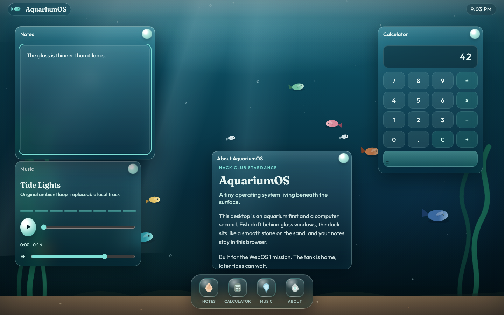

# AquariumOS

A browser desktop with an aquarium behind it. Feed the fish to grow them, open apps from the sand, and switch to night to use your cursor as a lantern.

[Demo](https://ethaenall.github.io/aquariumos/)
[Source](https://github.com/ethaenall/aquariumos)



## Using it

Click the objects in the sand to open the apps. Right now we have these apps available: Notes, Calculator, Music, and Field Guide. Click empty water to feed the fish. Notes and fish progress save in your browser.
You can drag, minimize, maximize, and snap windows. Press `Esc` to close a window or `⌘K` / `Ctrl K` to search for apps and fish.
Additionally, if you move your mouse cursor around, you diplace the water and cause ripples. Also if you put your cursor on the fish you can move them around a little bit.
Theres a bunch of different type of fish evolutions so have fun.

## Run locally

From the project folder:

```bash
python3 -m http.server 8000
```

Open [localhost:8000](http://localhost:8000). Built with HTML, CSS, and JavaScript.

## Credits

Made by [ethaenall](https://github.com/ethaenall) for [Hack Club Stardance](https://stardance.hackclub.com).

Fonts: [Fraunces](https://fonts.google.com/specimen/Fraunces) and [Outfit](https://fonts.google.com/specimen/Outfit). Music: Tide Lights, generated with `scripts/generate-tide-lights.py`.
